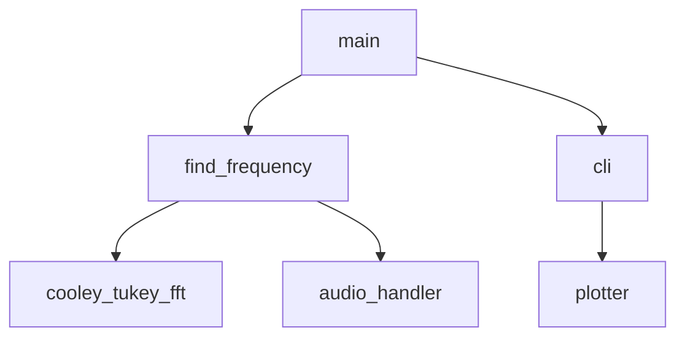
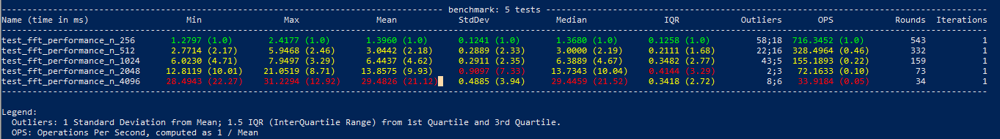

# Voimmakkaimman taajuuden löytäminen - Signaalinkäsittelyohjelma

Ohjelma käyttää Cooley-Tukeyn radix-2 DIT fft-algoritmia muuntamaan äänitiedoston taajusmuotoon, tulostaa aika- ja taajuusmuodon kaaviot pyplotin avulla, printtaa konsoliin voimakkaimman taajuuden arvon, sekä luo uudeen äänitiedoston (rajoitettu 5s pituuteen), joka koostuu voimakkaimmasta taajuudesta.

#### Huom! 
Ohjelmasta on olemassa myös versio, jossa numpyä ei käytetä muuten kuin testauksessa ja tiedostonluvussa branchillä numpyton. Numpy ei kauheasti eroa perus pythonista, mutta sellainen on varmuuden vuoksi.

# Ohjelman yleisrakenne

# Saavutetut aika- ja tilavaativuudet (esim. O-analyysit pseudokoodista)

Teorettisesti aikavaativuuden saavutettu aikavaativuus on O(n log n).
Suorituskykytestien myötä käy tosin ilmi, että ohjelma ei täysin seuraa O(n log n) aika-vaativuutta oikeassa ympäristössä

# Työn mahdolliset puutteet ja parannusehdotukset

Käyttöliittymä hyvin karkea (periaattessa ei ollenkaan), ohjelma täytyy suorittaa uudelleen jokaisen tiedoston jälkeen. Näppärämpi käyttöliittymä jollain file explorerilla olisi mukava. 

# Laajojen kielimallien käyttö.

Projektin alussa ChatGPT:tä (verkkosivun versiota) ymmärtämään algoritmin syötteitä ja myös soundfile kirjaston read tulostusta (voiko vain heittää sen algoritmiin suoraan). Testauksessa expected arvojen nopea laskeminen alkujoukoista. Testauksessa apua miten pytestissä voi sulkea pois joitain testejä.

# Merkitykselliset lähteet

[Fast Fourier-transform (Wikipedia)](https://en.wikipedia.org/wiki/Fast_Fourier_transform)
 
[Cooley-Tukey (Wikipedia)](https://en.wikipedia.org/wiki/Cooley%E2%80%93Tukey_FFT_algorithm)
 
[Testisyötteiden kannalta hyödyllinen dst.stackexchange kommentti](https://dsp.stackexchange.com/a/634)
 
[Tehokkaampi padaus](https://stackoverflow.com/questions/64764893/zero-pad-an-array-to-the-next-power-of-2-size)
